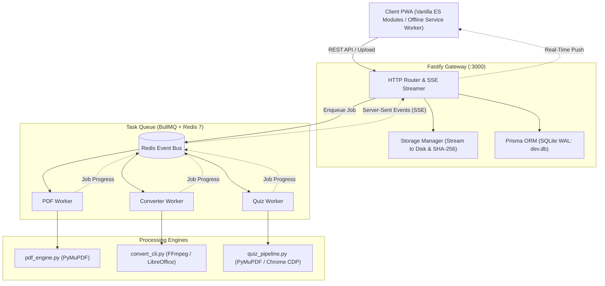

<div align="center">

# DuyDev Studio

**Personal Progressive Web App (PWA) & self-hosted file processing suite.**

English · [Tiếng Việt](README.vi.md)

[](https://studio.duydev.cloud)
[](https://studio.duydev.cloud)
[](https://nodejs.org/)
[](https://fastify.dev/)
[](https://www.typescriptlang.org/)
[](https://www.python.org/)
[](LICENSE)

<p align="center">
  🌐 <b>Live Instance:</b> <a href="https://studio.duydev.cloud">https://studio.duydev.cloud</a>
</p>

</div>

---

## Overview

**DuyDev Studio** is a personal self-hosted Progressive Web App (PWA) that aggregates specialized document, media, and file processing utilities into a single high-performance workspace. Designed for homeserver operation with zero artificial file size throttles, full data privacy, and offline capabilities.

- **Frontend**: Zero-build native ES Modules, Tailwind CSS, Service Worker (offline-first PWA), and Lucide Icons.
- **Backend Gateway**: Fastify v4 (TypeScript strict mode), streaming files directly to disk in 4MB chunks with inline SHA-256 calculation.
- **Background Queue**: BullMQ over Redis 7, asynchronously handling compute-heavy tasks (video transcoding, PDF compilation, quiz extraction).
- **Database**: SQLite WAL mode managed through Prisma ORM.
- **Processing Engines**: PyMuPDF (`fitz`), FFmpeg CLI, LibreOffice headless, Pillow, `pdf2docx`, and Chromium CDP.

---

## Core Modules

### 1. PDF Studio
- **Merge & Split**: Combine multiple PDF documents with visual drag-and-drop reordering; split by custom page ranges or odd/even pages via interactive thumbnail grid.
- **Page Rotation**: Rotate individual pages or whole documents by 90°, 180°, or 270°.
- **Compression**: Multi-tier optimization with automatic original file preservation if compressed size does not decrease.
- **Conversion**: Batch image-to-PDF conversion with A4 auto-fit; extract all embedded images from PDFs directly into a ZIP archive.
- **Watermarking & Security**: Add custom text watermarks, automated page numbering, AES password encryption, and permission unlocking.

### 2. Quiz Generator
- **Document Ingestion**: Extract exercise questions from uploaded PDFs or Google Drive links, with two-column layout parsing and automated diagram/table extraction.
- **Supported Question Formats**: 4-choice multiple choice (A, B, C, D), 4-statement True/False questions (a, b, c, d), and short-answer questions.
- **Scientific Rendering**: KaTeX vector rendering for mathematics, physics, and chemical formulas.
- **Print-Ready Output**: Concurrently generates clean A4 portrait worksheets (`DeBai.pdf`) and detailed answer matrices with step-by-step explanations (`DapAn.pdf`).

### 3. Universal File Converter
- **65+ Supported Formats**:
  - *Images*: WebP, PNG, JPG, ICO, BMP, TIFF, SVG.
  - *Video & Audio*: MP4, WebM, GIF, MP3, WAV, AAC, FLAC, OGG, M4A.
  - *Documents & Spreadsheets*: PDF, DOCX, Markdown, TXT, HTML, CSV, XLSX.
  - *Archives*: ZIP, TAR, 7Z, GZ.
- **Hybrid Fast-Path Architecture**: In-browser client conversion for lightweight images and data; automatic handoff to multi-threaded backend workers (FFmpeg, PyMuPDF, LibreOffice) for heavy media or complex document formats.

### 4. ViewSplit Image Comparator
- **Multi-Pane Layouts**: Compare 1, 2, 3, or 4 images side-by-side simultaneously.
- **Inspection Modes**: Side-by-side comparison, draggable Before/After slider wipe, and pixel difference mapping.
- **Pixel Inspector**: 9×9 pixel magnification loupe with reticle crosshairs, real-time RGB/HEX color readout, and exact pixel coordinates.
- **Synchronized Navigation**: Optional cross-pane synchronization for zooming, panning, and cursor tracking.

### 5. Archive Inspector
- **Zero-Extraction Inspection**: Read the Central Directory headers of `.zip`, `.rar`, and `.7z` archives directly to inspect directory trees and download individual files without decompressing the entire archive to disk.
- **Standard ZIP Archiving**: Package files and folders into UTF-8 standardized ZIP archives.

### 6. Dynamic QR Studio & VietQR
- **VietQR EMVCo**: Generate interbank 24/7 Napas payment QR codes with CRC16-CCITT checksum validation.
- **Dynamic QR & URL Redirection**: Route short links via `/q/:slug` with scan counting and access logs.
- **Content Types**: Wi-Fi network credentials, URLs, plaintext, and standardized UTF-8 vCard 3.0 contacts.
- **Scanner & Decoder**: Decode QR codes from file uploads, screen grabs, or direct clipboard pastes.

### 7. Storage Drive
- **Personal File Manager**: Hierarchical folder navigation, directory creation, safe renaming, chunked streaming uploads, and folder-to-ZIP exports.
- **Session Security**: Admin authentication barrier safeguarding stored server files.
- **Traversal Sandboxing**: Strict path sanitization (`sanitizeSafePath`) blocking directory traversal attacks.

### 8. Utilities & Universal Previewer
- **Hash Verification**: Compute MD5 and SHA-256 hashes for files or strings; Base64 encoder/decoder.
- **Studocu Downloader**: Educational document conversion to PDF.
- **Universal File Viewer**: Live in-browser preview for Word (`.docx`), Excel (`.xlsx`, `.csv`), PDF documents, media streams, syntax-highlighted source code, and binary Hex Dump.

---

## System Architecture



---

## Technology Stack

| Layer | Technologies |
| :--- | :--- |
| **Frontend** | Vanilla ES Modules, Tailwind CSS, Lucide Icons, PDF.js, SheetJS, `docx-preview`, `qr-code-styling` |
| **Backend** | Node.js v20+, Fastify v4, TypeScript, Zod |
| **Queue & Database** | Redis 7 (BullMQ), SQLite WAL (Prisma ORM) |
| **Document Processing** | Python 3.11, PyMuPDF (`fitz`), LibreOffice headless, `pdf2docx`, `python-docx` |
| **Media Processing** | FFmpeg, Pillow, Sharp |
| **Testing** | Vitest, TypeScript Compiler (`tsc --noEmit`) |

---

## Local Setup & Development

### 1. Prerequisites
- **Node.js**: v20.x or higher
- **Python**: 3.10+ (3.11 recommended)
- **Redis Server**: Running at `127.0.0.1:6379`
- **System Binaries** (optional, for media/office tasks): `ffmpeg`, `libreoffice`

### 2. Installation

```bash
# Clone the repository
git clone https://github.com/anhduyalpha/DuyDev-Studio.git
cd DuyDev-Studio

# 1. Install Backend Dependencies & Initialize SQLite DB
cd server
npm install
cp .env.example .env
npx prisma generate
npx prisma db push
cd ..

# 2. Install Python Engine Dependencies
pip install -r engines/converter/fastapi_app/requirements.txt
pip install PyMuPDF pdf2docx python-docx Pillow
```

### 3. Start Development Server

```bash
# Run Fastify gateway (serves both API and frontend PWA)
npm run dev

# Or directly from the server directory:
cd server && npm run dev
```

Access the application at: **`http://localhost:3000`** *(or configured port in `server/.env`)*.

---

## Testing & Quality Assurance

```bash
cd server

# 1. TypeScript Static Typecheck
npm run build      # npx tsc --noEmit (Must pass with 0 errors)

# 2. Run Test Suite
npm test           # npx vitest run
```

---

## Deployment

The application runs seamlessly on personal Linux homeservers or VPS instances managed via Systemd behind Cloudflare Zero Trust Tunnel:

```bash
# Systemd service management
sudo systemctl status dd-studio.service
sudo systemctl restart dd-studio.service
```

---

## License

Distributed under the [MIT License](LICENSE).
