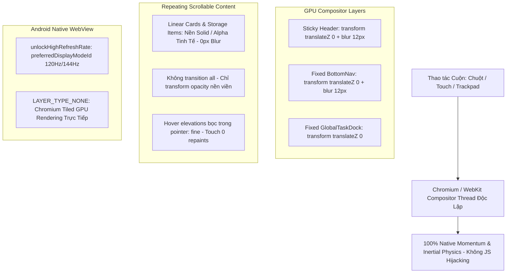

# KI-CON-012: Chuẩn Hóa Kiến Trúc Cuộn Native 120Hz/144Hz Trên Compositor Thread & Xóa Bỏ Hoàn Toàn JS Scroll Hijacking (Lenis, Root Class Thrashing)

---

## 1. Metadata
- **ID:** `KI-CON-012`
- **Tiêu đề:** Chuẩn Hóa Kiến Trúc Cuộn Native 120Hz/144Hz Trên Compositor Thread & Xóa Bỏ Hoàn Toàn JS Scroll Hijacking (Lenis, Root Class Thrashing)
- **Loại:** `concept`
- **Lĩnh vực:** `fullstack`
- **Tình trạng:** `verified`
- **Tags:** `native-compositor`, `120hz`, `gpu-layers`, `no-scroll-hijacking`, `touch-ergonomics`, `android-webview`, `pwa`
- **Ngày cập nhật:** 2026-10-14
- **Tác giả:** DuyDev Studio Engineering

---

## 2. Bối Cảnh & Phân Tích Nguyên Nhân Gốc Rễ (Root-Cause Postmortem)
Trong phiên bản thử nghiệm `v22.74`, nỗ lực can thiệp làm mượt cuộn bằng thư viện JS (`Lenis`) và script tối ưu (`scrollOptimizer.js`) đã vô tình tạo ra 4 nút thắt nghiêm trọng gây tụt FPS và lag cuộn:

1. **Root Class Thrashing (`scrollOptimizer.js` & `html.is-scrolling`):**
   Việc liên tục gắn và gỡ class `.is-scrolling` trên thẻ gốc `<html>` khi bắt đầu và dừng cuộn để tắt `backdrop-filter` đã ép trình duyệt thực hiện Full-Document Style Recalculation, Paint Invalidation và kích hoạt hàng loạt CSS transitions ngay lúc cuộn nhạy cảm nhất.
2. **Main-Thread Scroll Hijacking (`lenis.js` & `smoothScroll.js`):**
   Can thiệp sự kiện lăn chuột (`wheel`) trên JS Main Thread thông qua vòng lặp `requestAnimationFrame` + `MutationObserver` làm tê liệt Compositor Thread độc lập của trình duyệt. Bất cứ khi nào Main Thread bận xử lý DOM hay JSON, khung hình cuộn lập tức bị khựng (stutter).
3. **Android WebView Texture Bottleneck (`MainActivity.kt`):**
   Việc đặt `View.LAYER_TYPE_HARDWARE` trực tiếp lên `WebView` ép hệ thống Android phải rasterize toàn bộ WebView thành một texture FBO ngoại màn hình khổng lồ trên mỗi frame cuộn, phá vỡ kiến trúc multi-threaded tiled compositor siêu mượt vốn có của Chromium.
4. **Layout Shift từ `content-visibility: auto` không cố định chiều cao:**
   Việc áp dụng `content-visibility: auto` lên danh sách card động mà không cố định kích thước nội tại chính xác gây giật layout (layout thrashing) khi cuộn nhanh.

---

## 3. Kiến Trúc Chuẩn 120Hz Native Compositor (True 120Hz Architecture)



### 3.1. Cô Lập Thanh Điều Hướng Cố Định Lên GPU Layer Riêng Biệt
- Chỉ áp dụng `backdrop-filter: blur(12px)` trên các thanh chrome cố định duy nhất của ứng dụng: Header (`.glass-panel`) và thanh điều hướng đáy (`.glass-dock`).
- Thúc đẩy thanh điều hướng thành dedicated GPU layer:
  ```css
  transform: translateZ(0);
  will-change: transform;
  backface-visibility: hidden;
  ```
- Tuyệt đối không vượt quá bán kính `12px` blur để đảm bảo render budget $< 8.33$ms trên màn hình 120Hz.

### 3.2. Triệt Tiêu Hoàn Toàn `backdrop-filter` Trên Các Thẻ Lặp Lại Khi Cuộn
- Loại bỏ toàn bộ `backdrop-filter` trên các thẻ nội dung xuất hiện lặp lại khi cuộn: `.linear-card`, `.recent-activity-card`, `.tool-accent-box`, các nút action trên thumbnail `StoragePage`.
- Thay thế bằng các surface token màu nền solid/alpha tinh tế (Light: `#FFFFFF`, Dark: `#151821`), giữ nguyên độ tương phản và sang trọng mà không tốn dù chỉ 1 pass Gaussian blur shader của GPU.

### 3.3. Cấm `transition: all` & Bảo Vệ Trạng Thái Hover Cho Màn Hình Cảm Ứng
- Thay thế toàn bộ `transition: all` bằng danh sách thuộc tính an toàn cho compositor:
  ```css
  transition: transform 0.18s cubic-bezier(0.22, 1, 0.36, 1),
              opacity 0.18s ease,
              background-color 0.15s ease,
              border-color 0.15s ease,
              box-shadow 0.18s ease;
  ```
- Đưa toàn bộ hiệu ứng `:hover` (nâng thẻ, đổi viền, đổ bóng) vào trong block `@media (hover: hover) and (pointer: fine)`. Khi người dùng vuốt cuộn trên điện thoại Android/iOS, thao tác chạm sẽ **không bao giờ** kích hoạt style recalculation hay repaint hover.

### 3.4. Giữ Mở Khóa Tần Số Quét Cao & Khôi Phục `LAYER_TYPE_NONE` Trên Android
- Giữ vững hàm `unlockHighRefreshRate()` trong `MainActivity.kt` (`params.preferredDisplayModeId = maxMode.modeId`) để màn hình 120Hz/144Hz không bị hệ điều hành bóp về 60Hz.
- Khôi phục `webView.setLayerType(View.LAYER_TYPE_NONE, null)` để Chromium tự do phân bổ bộ nhớ GPU dạng tiled compositor thay vì ép vào một texture FBO duy nhất.

### 3.5. Giải Mã Ảnh Bất Đồng Bộ (`decoding="async"`)
- Tất cả các thẻ `` trong danh sách nặng (`StoragePage.js`, `TiktokWorkspace.js`) đều có cả `loading="lazy"` và `decoding="async"` để việc giải mã ảnh JPEG/PNG/WebP diễn ra hoàn toàn ngoài Main Thread.

---

## 4. Các Quy Tắc Cấm Kỵ Tuyệt Đối (Anti-Patterns)
1. **CẤM** import bất kỳ thư viện JS smooth-scroll hay wheel interceptor nào (`Lenis`, `Locomotive`, `SmoothScroll.js`).
2. **CẤM** gắn/gỡ class trên thẻ `<html>` hoặc `<body>` trong sự kiện `scroll` (`is-scrolling`).
3. **CẤM** đặt `backdrop-filter` trên các thẻ lặp lại trong danh sách cuộn.
4. **CẤM** dùng `View.LAYER_TYPE_HARDWARE` trên `WebView` của Android.
