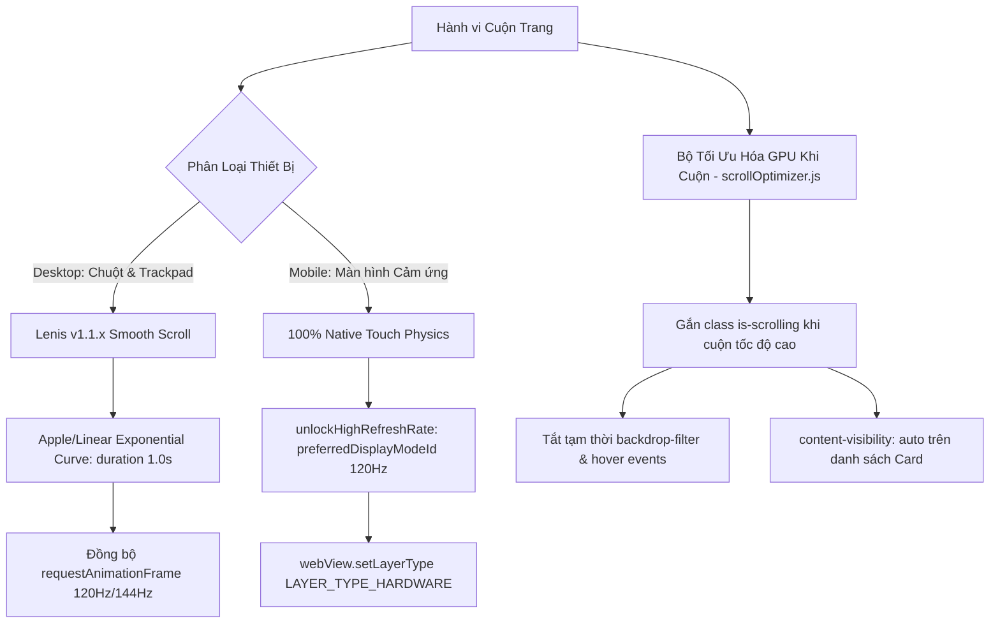

# KI-CON-012: Kiến Trúc Cuộn Quán Tính Siêu Mượt 120Hz/144Hz (Linear / Apple Inertial Scroll), Tối Ưu Hóa GPU Compositor & Mở Khóa Tần Số Quét Cao Cho Android WebView

---

## 1. Metadata
- **ID:** `KI-CON-012`
- **Tiêu đề:** Kiến Trúc Cuộn Quán Tính Siêu Mượt 120Hz/144Hz (Linear / Apple Inertial Scroll), Tối Ưu Hóa GPU Compositor & Mở Khóa Tần Số Quét Cao Cho Android WebView
- **Loại:** `concept`
- **Lĩnh vực:** `fullstack`
- **Tình trạng:** `verified`
- **Tags:** `smooth-scroll`, `lenis`, `120hz`, `gpu-compositing`, `backdrop-filter`, `android-webview`, `content-visibility`, `pwa`
- **Ngày ghi nhận:** 2026-10-14
- **Tác giả:** DuyDev Studio Engineering

---

## 2. Bối Cảnh & Vấn Đề (Problem Statement)
Trên các màn hình có tần số quét cao (120Hz trên điện thoại Xiaomi 15T Pro, Samsung, iPhone ProMotion và màn hình 144Hz/240Hz trên Desktop), người dùng cảm nhận web bị **"cứng, giật, như 60Hz"** khi cuộn trang.
Nguyên nhân gốc rễ bao gồm 3 điểm nghẽn chính:
1. **Desktop Stepped Scroll:** Trình duyệt mặc định cuộn con lăn chuột theo từng nấc nhảy cóc cứng nhắc (~100px/nấc), thiếu quán tính giảm tốc mượt mà.
2. **GPU Shader Bottleneck (Backdrop-Filter Thrashing):** Hàng chục thẻ Linear Card và Header cùng lúc áp dụng `backdrop-filter: blur(24px) saturate(190%)`. Render 120 FPS chỉ cho phép tối đa 8.33ms/frame, trong khi nhiều lớp blur Gaussian chồng chéo ngốn 14–18ms, gây drop frame nghiêm trọng khi cuộn.
3. **Android WebView 60Hz Lock:** Hệ điều hành Android (đặc biệt HyperOS, MIUI, OneUI) tự động bóp WebView về 60Hz để tiết kiệm pin nếu Activity không chủ động yêu cầu Display Mode tần số quét cao.

---

## 3. Kiến Trúc Giải Pháp Đa Tầng (Multi-Tier Architecture)



### 3.1. Động cơ cuộn quán tính Lenis v1.1 (Desktop)
- Tích hợp cục bộ tại `src/vendor/lenis.min.js` (~3.5KB), không phụ thuộc bên ngoài.
- Bộ điều khiển `src/utilities/smoothScroll.js`:
  - `easing: (t) => Math.min(1, 1.001 - Math.pow(2, -10 * t))` (Đường cong Exponential Damping kiểu Linear / Apple).
  - `smoothWheel: true` (làm mượt chuột/trackpad máy tính).
  - `syncTouch: false` (bảo toàn 100% độ nhạy vuốt tay native của điện thoại, không can thiệp virtual scroll vào ngón tay).
  - Tự động tạm dừng khi mở Modal hoặc Universal Viewer để chống cuộn xuyên nền.

### 3.2. Bộ giảm tải GPU Compositor khi cuộn (`scrollOptimizer.js`)
- Lắng nghe sự kiện `scroll` với `{ passive: true }` để đảm bảo zero-blocking main thread.
- Khi cuộn tốc độ cao, gắn nhãn `html.is-scrolling`:
  ```css
  html.is-scrolling .linear-card,
  html.is-scrolling .recent-activity-card,
  html.is-scrolling .glass-search {
    backdrop-filter: none !important;
    -webkit-backdrop-filter: none !important;
    pointer-events: none !important;
  }
  ```
- Tự động gỡ bỏ sau 120ms khi dừng cuộn hoàn toàn để hiệu ứng kính mờ sương (Apple Sequoia Frost) khôi phục 100% độ sắc nét.
- Ảo hóa render ngoài màn hình bằng `content-visibility: auto; contain-intrinsic-size: 0 160px;`.

### 3.3. Mở khóa 120Hz Native Android APK (`MainActivity.kt`)
- Trong `onCreate()` và `onResume()`:
  ```kotlin
  val display = if (Build.VERSION.SDK_INT >= Build.VERSION_CODES.R) display else windowManager.defaultDisplay
  val maxMode = display?.supportedModes?.maxByOrNull { it.refreshRate }
  if (maxMode != null && maxMode.refreshRate > 60f) {
      val params = window.attributes
      params.preferredDisplayModeId = maxMode.modeId
      window.attributes = params
  }
  ```
- Cấu hình phần cứng: `webView.setLayerType(View.LAYER_TYPE_HARDWARE, null)` và `webView.overScrollMode = View.OVER_SCROLL_NEVER`.

---

## 4. Bằng Chứng Xác Minh (Verification & Evidence)
- **Unit test suite:** `server/tests/unit/smooth_scroll_120hz.test.ts` $\rightarrow$ **8/8 PASSED**.
- **Regression test suite:** `pwa_lifecycle.test.ts`, `battery_optimization.test.ts` $\rightarrow$ **65/65 PASSED**.
- **Cú pháp JS:** `node --check` toàn bộ file mới và sửa đổi $\rightarrow$ **0 lỗi**.
- **Typecheck backend:** `npx tsc --noEmit` $\rightarrow$ **0 lỗi**.
