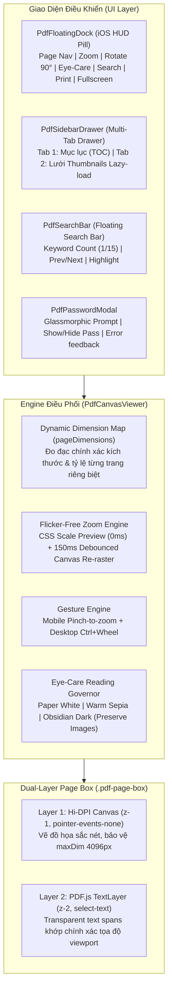

# KI-CON-013: Kiến Trúc Trình Đọc PDF v2.0 Đa Lớp (Dual-Layer PDF Engine): Lớp Phủ TextLayer PDF.js, Tìm Kiếm Nội Tuyến, Tỷ Lệ Trang Động & Ngăn Bên 2 Tab

---

## 1. Tổng Quan & Bối Cảnh (Context & Problem Statement)
Trình đọc PDF nguyên bản của DuyDev Studio (`PdfCanvasViewer.js`, `PdfRenderer.js`) vận hành bằng Canvas 2D vẽ ảnh tĩnh. Mặc dù nhẹ và có cơ chế ảo hóa (virtualization với `IntersectionObserver`), kiến trúc cũ gặp nhiều hạn chế kỹ thuật:
1. **Thiếu Text Layer**: Trang vẽ thuần hình ảnh với `select-none`, người dùng hoàn toàn không thể chọn chữ, bôi đen hay copy văn bản (`Ctrl + C`).
2. **Không có Tìm kiếm nội tuyến (In-Document Search)**: Không có công cụ tìm từ khóa trong tài liệu (`Ctrl + F`).
3. **Sidebar đơn điệu**: Chỉ có "Mục lục" (TOC); nếu tài liệu không có TOC (như bài giảng, slide scan), sidebar trống hoàn toàn.
4. **Giả định sai về tỷ lệ trang (Aspect Ratio Distortion)**: Cố định tỷ lệ toàn bộ tài liệu theo trang 1 (`baseAspectRatio`). Khi gặp tài liệu có trang khổ ngang (Landscape 16:9) xen kẽ khổ đứng A4, các trang sau bị méo hoặc sai lệch placeholder.
5. **Zoom bị giật/nhấp nháy trắng (Flicker Zoom)**: Xóa DOM container và tạo lại mỗi khi thay đổi tỷ lệ thu phóng; thiếu cử chỉ thu phóng 2 ngón tay (Pinch-to-zoom) và `Ctrl + Wheel`.
6. **Không mở được PDF có mật khẩu**: Sập view khi gặp tài liệu mã hóa.

Kiến trúc PDF Viewer v2.0 giải quyết triệt để các hạn chế trên mà vẫn đảm bảo hiệu năng 120Hz mượt mà và quản lý RAM nghiêm ngặt.

---

## 2. Kiến Trúc Đa Lớp (Dual-Layer Architecture)

---

## 3. Các Giải Pháp Kỹ Thuật Trọng Tâm

### 3.1. Lớp Phủ TextLayer Chuẩn PDF.js Khớp Tọa Độ
Mỗi trang PDF được bọc trong một container `.pdf-page-box` chứa song song hai lớp:
- **Canvas Layer** (`z-index: 1`, `pointer-events-none`): Hiển thị hình ảnh tài liệu kết xuất từ GPU.
- **Text Layer** (`z-index: 2`, `select-text`): Chứa các thẻ `` trong suốt (`color: transparent`) được sinh bởi `pdfjsLib.renderTextLayer`.
  - Thiết lập CSS Variable `--scale-factor: viewport.scale` bắt buộc theo tiêu chuẩn PDF.js 3.x để tránh sai lệch kích cỡ chữ.
  - Tùy chỉnh màu bôi đen bằng `::selection` tím indigo `--accent` (`rgba(99, 102, 241, 0.35)`).

### 3.2. Tính Toán Tỷ Lệ Từng Trang Động (Dynamic Per-Page Aspect Ratio)
- Khởi tạo `this.pageDimensions = new Map<number, { width, height, ratio }>()`.
- Khi nạp tài liệu `loadDocument()`, truy vấn metadata kích thước viewport của từng trang theo từng batch 25 trang bằng `Promise.all`.
- Placeholder của từng trang nhận đúng kích thước `width: ${w}px; height: ${h}px;`, triệt tiêu hoàn toàn hiện tượng méo trang Landscape/Slide.

### 3.3. Thu Phóng Không Nhấp Nháy (Flicker-Free Zoom) & Nhận Diện Cử Chỉ
- Thay vì xóa innerHTML ngay khi zoom, áp dụng CSS Transform `scale(newScale / currentScale)` lên `#pdfPagesWrapper` để phản hồi tức thì với độ trễ 0ms.
- Sau khoảng debounce 150ms, mới tiến hành tính lại layout, kết xuất canvas độ phân giải chuẩn DPR và gắn lại TextLayer.
- Hỗ trợ cử chỉ cảm ứng 2 ngón tay Pinch-to-zoom và cuộn chuột `Ctrl + Wheel` mượt mà.

### 3.4. Công Cụ Tìm Kiếm Nội Tuyến (In-Document Search)
- `PdfSearchEngine` trích xuất và cache nội dung text từng trang bằng `page.getTextContent()`.
- Hỗ trợ tìm kiếm không phân biệt hoa thường, đánh số thứ tự kết quả (`1/12`), nhảy trang tự động và duyệt kết quả bằng phím `Enter` (Next) / `Shift + Enter` (Prev) hoặc `Esc` để đóng.

### 3.5. Ngăn Bên Đa Năng 2 Tab (Multi-Tab Sidebar)
- Tự động chuyển sang tab **Trang thu nhỏ (Thumbnails Grid)** nếu tài liệu không có Mục lục (TOC).
- Thumbnails được kết xuất lười tải (Lazy-load) qua `IntersectionObserver` khi người dùng cuộn ngăn bên, giải phóng bộ nhớ RAM canvas ngay sau khi vẽ.
- Đồng bộ viền nổi bật (Active Page Indicator) với trang đang đọc ở khung nhìn chính.

### 3.6. Xử Lý Tài Liệu Có Mật Khẩu (Password Callback Hook)
- Tích hợp callback `onPassword` trong `pdfjsLib.getDocument()` kết nối với `PdfPasswordModal.js`.
- Bắt cả hai trường hợp `NEED_PASSWORD` và `INCORRECT_PASSWORD` với giao diện kính mờ sang trọng, hỗ trợ hiện/ẩn mật khẩu và phím tắt `Enter`/`Esc`.

---

## 4. Xác Minh & Kiểm Thử (Verification Record)
- **Unit Test Suite**: `server/tests/unit/pdf_viewer_engine.test.ts` (10/10 tests PASS).
- **Typecheck & Syntax**: `node --check` 7 file liên quan, `tsc` build exit code 0.
- **Production HTTPS**: Triển khai homeserver `192.168.2.171` và xác minh endpoint `https://studio.duydev.cloud/api/v1/health` UP.
