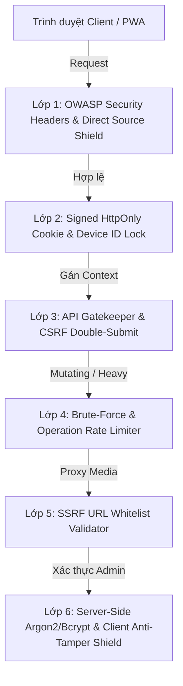

# KI-CON-020: Kiến Trúc Bảo Mật Phòng Thủ Đa Tầng Toàn Diện (Defense-in-Depth Security Hardening)

> **ID**: `KI-CON-020`  
> **Lĩnh vực**: `fullstack` · `security` · `backend` · `frontend`  
> **Tình trạng**: `verified`  
> **Ngày tạo**: 02/11/2026  
> **Phiên bản áp dụng**: `v24.34` trở lên  
> **Tài liệu liên quan**: [AGENTS.md](../../AGENTS.md), [ARCHITECTURE.md](../ARCHITECTURE.md), [`server/src/api/middleware/security.middleware.ts`](file:///server/src/api/middleware/security.middleware.ts), [`src/utilities/securityShield.js`](file:///src/utilities/securityShield.js)

---

## 1. Bối cảnh & Mục đích

DuyDev Studio là nền tảng PWA đa năng cung cấp các công cụ xử lý tệp tin, trích xuất dữ liệu mạng xã hội (Facebook, Instagram, TikTok, YouTube, Spotify), chuyển đổi tài liệu và quản lý lưu trữ cá nhân (Studio Drive). Trước phiên bản `v24.34`, hệ thống tồn tại các sơ hở bảo mật:
1. **Rò rỉ & Giả mạo Device ID (IDOR)**: Client tự gửi header `x-device-id` tùy ý mà không có chữ ký số xác thực từ máy chủ, dẫn đến nguy cơ dò quét lịch sử và thùng rác của người dùng khác.
2. **Nguy cơ Tấn công CSRF & Cross-Site Hotlinking**: Thiếu kiểm tra nguồn gốc (`Sec-Fetch-Site`, `Origin`) và thiếu mã chống CSRF trên các phương thức HTTP biến đổi dữ liệu (`POST`, `PUT`, `DELETE`).
3. **Lộ Mã Nguồn Client & Thiếu Lá Chắn Anti-DevTools**: Người dùng có thể trực tiếp mở file JS trong `/src/` qua thanh địa chỉ trình duyệt; mã băm mật khẩu quản trị bị lưu cứng trong `adminAuth.js`.
4. **Nguy cơ Tấn công SSRF (Server-Side Request Forgery)**: Các API proxy luồng video/ảnh chưa lọc triệt để các địa chỉ IP nội bộ (`localhost`, `127.0.0.1`, `10.*`, `192.168.*`, `169.254.*`).
5. **Brute-Force Đăng Nhập Quản Trị**: Chưa có cơ chế giới hạn số lần thử mật khẩu và khóa tạm thời tại máy chủ.

`KI-CON-020` thiết lập mô hình bảo mật 6 lớp phòng thủ chiều sâu (Enterprise Defense-in-Depth), giải quyết triệt để các rủi ro trên mà không làm suy giảm trải nghiệm mượt mà của người dùng hợp lệ.

---

## 2. Kiến trúc 6 Lớp Phòng Thủ Chiều Sâu

### Lớp 1: Tiêu Chuẩn Tiêu Đề Bảo Mật OWASP & Lá Chắn Mã Nguồn
- **HTTP Security Headers**: Máy chủ Fastify tự động đính kèm các tiêu đề bảo mật trên mọi phản hồi:
  - `X-Content-Type-Options: nosniff` (chống MIME confusion).
  - `X-Frame-Options: SAMEORIGIN` và `Content-Security-Policy: frame-ancestors 'self'; object-src 'none'; base-uri 'self';` (chống Clickjacking).
  - `Referrer-Policy: strict-origin-when-cross-origin` (bảo vệ thông tin URL nhạy cảm).
  - `Permissions-Policy: camera=(), microphone=(), geolocation=()` (vô hiệu hóa API phần cứng không dùng).
- **Lá chắn truy cập trực tiếp `/src/`**: Khi người dùng nhập trực tiếp URL như `https://studio.duydev.cloud/src/app.js` vào thanh địa chỉ trình duyệt, trình duyệt gửi `Sec-Fetch-Dest: document` hoặc `Sec-Fetch-Mode: navigate`. Hook `onRequest` phát hiện và trả về HTTP 403 Forbidden ngay lập tức, trong khi các yêu cầu nạp script hợp lệ (`Sec-Fetch-Dest: script`) từ `index.html` vẫn hoạt động trơn tru.

### Lớp 2: Cookie Phiên Ký Số HMAC & Khóa Cứng Định Danh Thiết Bị (Anti-IDOR)
- **Tự động cấp phát**: Khi người dùng ghé thăm trang web lần đầu, `cookieSessionIssuerHook` phát hành:
  - `ds_session` (`HttpOnly; Secure; SameSite=Lax; Path=/`): Chứa payload `{deviceId}.{expiresAt}` được ký bằng HMAC-SHA256 bí mật ở máy chủ.
  - `ds_csrf` (`SameSite=Lax; Secure; Path=/`): Mã CSRF HMAC mà JS client có thể đọc để phục vụ cơ chế Double-Submit.
  - `ds_device_id` (`SameSite=Lax; Secure; Path=/`): Định danh thiết bị bền vững 10 năm.
- **Khóa cứng Device ID**: Máy chủ giải mã và kiểm chứng chữ ký số của `ds_session`. Giá trị `req.headers['x-device-id']` được máy chủ ghi đè bằng `verifiedDeviceId` đã kiểm chứng. Client bên ngoài không thể giả mạo header để xâm phạm lịch sử của người khác.

### Lớp 3: API Gatekeeper & Kiểm Chứng CSRF Double-Submit
- **Chặn đứng Cross-Site**: Toàn bộ endpoint `/api/v1/*` được bảo vệ bởi `apiSecurityGuard`:
  - Từ chối mọi yêu cầu có `Origin` lạ không nằm trong danh sách trắng (`studio.duydev.cloud`, `localhost`, LAN IP).
  - Từ chối ngay nếu trình duyệt gửi `Sec-Fetch-Site: cross-site`.
- **CSRF Double-Submit**: Với các phương thức thay đổi trạng thái (`POST`, `PUT`, `DELETE`, `PATCH`), người dùng phải gửi kèm header `X-DS-CSRF` khớp với cookie `ds_csrf` hoặc chữ ký HMAC của máy chủ.

### Lớp 4: Chống Brute-Force Mật Khẩu Quản Trị
- **Khóa IP Tạm Thời**: Trong `AuthService`, quản lý bộ nhớ `loginAttempts`:
  - Ghi nhận số lần thử đăng nhập thất bại theo IP thực (`cf-connecting-ip` hoặc `x-forwarded-for`).
  - Nếu nhập sai quá 5 lần liên tiếp: Khóa IP trong 15 phút (900 giây) và trả về HTTP 429 Too Many Requests kèm thông báo rõ ràng.
  - Khi nhập đúng mật khẩu: Đặt lại bộ đếm thất bại về 0.

### Lớp 5: Thẩm Định Luồng Media Chống SSRF (Server-Side Request Forgery)
- **Hàm thẩm định `validateSafeMediaUrl`**:
  - Phân tích cú pháp URL an toàn bằng `URL`.
  - Cấm hoàn toàn các giao thức khác `http:` / `https:` (chặn `file:`, `ftp:`, `gopher:`).
  - Chặn đứng mọi địa chỉ IP lặp lại và dải mạng nội bộ: `localhost`, `127.0.0.1`, `::1`, `10.*`, `192.168.*`, `169.254.*` (AWS metadata IP), `172.16-31.*`, `.internal`, `.local`.
  - Bắt buộc hostname phải khớp hoặc kết thúc bằng danh sách tên miền CDN được phép (ví dụ `fbcdn.net`, `facebook.com` cho Facebook; `cdninstagram.com` cho Instagram).
  - Ném `BadRequestError` chuẩn hóa khi vi phạm.

### Lớp 6: Lá Chắn Client Anti-Tamper & Khử Bỏ Mã Băm Cứng
- **Khử bỏ mã băm cứng**: Xóa bỏ hoàn toàn các hằng số SHA-256 (`DEFAULT_HASH_ANHDUY`, v.v.) khỏi mã nguồn client `adminAuth.js`. Việc xác thực mật khẩu được chuyển 100% về endpoint `/api/v1/auth/verify`.
- **Anti-DevTools & Anti-Copy (`securityShield.js`)**:
  - Chặn các tổ hợp phím kiểm tra mã nguồn: `F12`, `Ctrl+Shift+I`, `Ctrl+Shift+J`, `Ctrl+Shift+C`, `Ctrl+U`, `Ctrl+S`.
  - Vô hiệu hóa chuột phải (`contextmenu`) trên trang, ngoại trừ bên trong các trường nhập liệu (`input`, `textarea`, `[contenteditable]`), trình phát âm thanh/video hoặc phần tử có class `.allow-select`.
  - **Tự Động Bỏ Qua Cho Quản Trị Viên & Localhost**: Khi quản trị viên đã xác thực (`isAdminAuthenticated() === true`) hoặc đang chạy trên máy dev (`localhost`, `127.0.0.1`), toàn bộ lá chắn client tự động tắt để phục vụ việc debug và phát triển thuận tiện.

---

## 3. Quy Tắc Khi Thêm Mô-Đun Hoặc API Mới

1. **Không tắt `apiSecurityGuard`**: Mọi route nghiệp vụ mới nằm trong `/api/v1/` mặc định đều phải được bảo vệ bởi Gatekeeper.
2. **Proxy media phải qua `validateSafeMediaUrl`**: Bất kỳ hàm nào fetch nội dung từ URL do người dùng cung cấp (`fetch(userUrl)`) bắt buộc phải gọi `validateSafeMediaUrl(userUrl, allowedDomainList)` trước khi fetch.
3. **Sử dụng `setupGlobalApiFetchInterceptor`**: Trên frontend, mọi API call phải sử dụng `fetch()` tiêu chuẩn của trình duyệt. Không tạo custom wrapper bỏ qua `credentials: 'same-origin'` hoặc header `X-DS-CSRF`.
4. **Tuyệt đối không lưu mật khẩu hay secret trong client JS**: Mọi thông tin nhạy cảm phải được bảo vệ bằng server-side session hoặc cookie `HttpOnly`.
